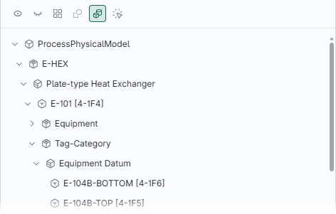
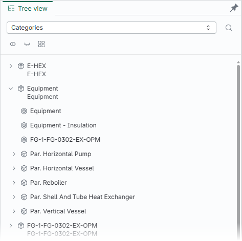
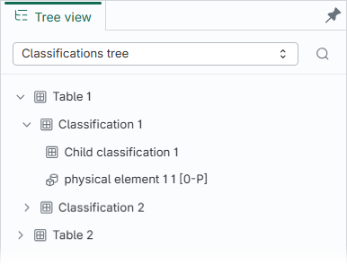

# @itwin/presentation-tree-definitions

Copyright © Bentley Systems, Incorporated. All rights reserved. See LICENSE.md for license terms and full copyright notice.

Reusable, UI-independent models, categories, and classifications trees backed by iModel data for custom tree components and other hierarchy-driven workflows. The trees are hierarchy definitions for [`@itwin/presentation-hierarchies`](../hierarchies/README.md), for use with a custom UI or with [`@itwin/presentation-hierarchies-react`](../hierarchies-react/README.md).

- [Using a tree](#using-a-tree)
- [Models tree](#models-tree)
- [Categories tree](#categories-tree)
- [Classifications tree](#classifications-tree)
- [ID Providers](#id-providers)

## Using a tree

Each tree factory takes `imodelAccess` for schema and query access, plus tree-specific `hierarchyConfig` (optional only for models). The optional `uniqueId` identifies the tree in query restart tokens and defaults to a generated GUID. Each factory returns:

- `hierarchyDefinition` for `createIModelHierarchyProvider` from `@itwin/presentation-hierarchies`.
- `createInstanceKeyPaths`, which yields `{ path, target }` pairs for targets found in the hierarchy.
- `createSearchTree`, which combines the paths for `HierarchyProvider.setHierarchySearch({ paths })`. Set `revealTargets: true` to expand ancestors of matches. See [hierarchy search](../hierarchies/learning/HierarchySearch.md) for details.

Both search helpers accept `abortSignal` and a `limit` (100 by default; `"unbounded"` disables it). They throw `SearchLimitExceededError` if the number of matches for `label`, or the number of supplied `targetItems` where supported, exceeds the limit.

A tree is bound to a single iModel version. To merge hierarchies from multiple versions of the same iModel, create one tree per version, pass the versions to `createMergedIModelHierarchyProvider` from earliest to latest, and return each tree’s definition for the matching access in the `getHierarchyDefinition` callback.

Each tree’s node namespace provides `is*Node` type guards and `getType`. In the diagrams below, `<…>` marks nodes or branches that appear only with certain settings or data.

## Models tree

### Models tree hierarchy

The models tree organizes 3D geometry by subject, model, and spatial category. The root subject is expanded automatically when shown. Models are labeled by their partitions, and categories group the model’s top-level elements.

```text
<Root subject (shown by default)>
├── <Child subject>
│   └── …
└── Model
    └── Category
        └── <Element class group (shown by default)>
            └── Element
                ├── <Same-category child elements, grouped by class by default>
                └── <Other categories, each with its child elements grouped by class by default>
```

- Connector-job subjects and hierarchy-type subjects are hidden, as are content models identified by partition JSON. Their children appear in their place.
- A sub-model node is hidden. Elements in the modeled element’s category appear under that element, with class grouping by default; other elements appear under their own categories.



_Image source: [`@itwin/tree-widget-react`](https://github.com/iTwin/viewer-components-react/tree/master/packages/tree-widget)._

### Models tree configuration

| Option                     | Effect                                                                                                       |
| -------------------------- | ------------------------------------------------------------------------------------------------------------ |
| `subjects.root`            | `"exclude"` omits the root Subject node and shows its children at the root.                                  |
| `subjects.labelMerging`    | `"disable"` keeps same-label sibling subject nodes separate.                                                 |
| `models.withoutElements`   | `"include"` allows models without elements.                                                                  |
| `models.labelMerging`      | `"disable"` keeps same-label sibling model nodes separate.                                                   |
| `categories.labelMerging`  | `"disable"` keeps same-label sibling category nodes separate.                                                |
| `elements.baseClass`       | Loads element nodes from the specified subclass of `BisCore.GeometricElement3d`.                             |
| `elements.excludedClasses` | Excludes elements of the listed classes and their subclasses, along with their child nodes.                  |
| `elements.classGrouping`   | `"disable"` shows elements without class groups; `"enable-with-counts"` adds element counts to group labels. |
| `hierarchyLevelFiltering`  | `"disable"` makes hierarchy levels non-filterable.                                                           |

### Models tree APIs

- `createModelsTree` creates the models tree. Its search helpers accept `label` or `targetItems` (instances or element class groups). Paths include hidden sub-models and content models by default; set `includeOnlyVisibleNodeInstanceKeys: true` to omit them.
- With label merging disabled for subjects, models, and categories, pass the definition and the paths from `createInstanceKeyPaths` to `createIModelHierarchyNodePaths` from `@itwin/presentation-hierarchies` to load nodes along each path. Leave `includeOnlyVisibleNodeInstanceKeys` off: the loader needs hidden model entries.
- `ModelsTreeNode` identifies subject, model, category, element, and element class grouping nodes.
- `createModelsTreeIdsProvider` creates a `ModelsTreeIdsProvider` for subject and model lookups and search paths. See [ID Providers](#id-providers).

## Categories tree

### Categories tree hierarchy

The categories tree shows spatial or drawing categories, either at the root or inside nested definition containers where supported by the schema. Sibling categories with the same label are merged.

```text
<Definition container>
├── <Nested definition container>
│   └── …
└── Category (same branches as a root category)
Category (outside a definition container)
├── <Sub-category>
└── <Element class group>
    └── Element
        ├── <Same-category child elements, grouped by class>
        └── <Other categories, each with its child elements grouped by class>
```

- For unmerged categories, sub-category nodes appear only when enabled and there is more than one non-private sub-category. Private sub-categories are not shown.
- When element nodes are included, class grouping always applies. Sub-categories and elements are separate branches. Sub-model contents appear under the modeled element without a visible model node.



_Image source: [`@itwin/tree-widget-react`](https://github.com/iTwin/viewer-components-react/tree/master/packages/tree-widget)._

### Categories tree configuration

| Option                       | Effect                                                                                                                                                                    |
| ---------------------------- | ------------------------------------------------------------------------------------------------------------------------------------------------------------------------- |
| `perspective` (required)     | `"3d"` uses `SpatialCategory`, `GeometricModel3d`, and `BisCore.GeometricElement3d`; `"2d"` uses `DrawingCategory`, `GeometricModel2d`, and `BisCore.GeometricElement2d`. |
| `categories.withoutElements` | `"include"` allows categories without elements.                                                                                                                           |
| `subCategories.nodes`        | `"exclude"` hides sub-category nodes.                                                                                                                                     |
| `elements.nodes`             | `"include"` shows element nodes under categories.                                                                                                                         |
| `elements.excludedClasses`   | When elements are included, excludes elements of the listed classes and their subclasses, along with their child nodes.                                                   |

### Categories tree APIs

- `createCategoriesTree` creates the categories tree. Its search helpers search by `label` only.
- `CategoriesTreeNode` identifies definition container, category, sub-category, model, element, and element class grouping nodes.
- `createCategoriesTreeIdsProvider` creates a `CategoriesTreeIdsProvider`. See [ID Providers](#id-providers).

## Classifications tree

### Classifications tree hierarchy

The classifications tree starts with the tables of the selected classification system. Under each table, classifications can contain child classifications and top-level 3D elements classified by them. Elements can have child elements of their own. The tree does not group elements by class or merge sibling labels.

```text
Classification table
└── <Classification>
    ├── <Child classification>
    │   └── …
    └── <Classified element>
        └── <Child element>
```



_Image source: [`@itwin/tree-widget-react`](https://github.com/iTwin/viewer-components-react/tree/master/packages/tree-widget)._

### Classifications tree configuration

| Option                                    | Effect                                                                                      |
| ----------------------------------------- | ------------------------------------------------------------------------------------------- |
| `rootClassificationSystemCode` (required) | Code of the classification system whose tables are shown at the root.                       |
| `elements.excludedClasses`                | Excludes elements of the listed classes and their subclasses, along with their child nodes. |

### Classifications tree APIs

- `createClassificationsTree` creates the classifications tree. Its search helpers accept `label` or `targetItems`.
- `ClassificationsTreeNode` identifies classification table, classification, and geometric element nodes.
- `createClassificationsTreeIdsProvider` creates a `ClassificationsTreeIdsProvider`. See [ID Providers](#id-providers).

## ID Providers

ID providers supply data used by tree hierarchies and searches. The hierarchy definition and search helpers share one provider, which the factory creates unless you supply one through `idsProvider`.

Use `createSharedIdsProvider` to create the `sharedIdsProvider` required by `createModelsTreeIdsProvider` or `createCategoriesTreeIdsProvider`. For classifications, pass `imodelAccess` and `hierarchyConfig` directly to `createClassificationsTreeIdsProvider`. Pass the resulting tree-specific provider to the corresponding factory's `idsProvider` prop. The provider interfaces also support custom implementations.

Every ID provider exposes the configuration used to create it through readonly `config`. Factory-created providers retain readonly snapshots, with defaults resolved and duplicate excluded classes removed. Classifications providers load classification data independently of shared providers and can be reused by trees with different element exclusions. Custom implementations must expose matching configuration metadata too.

Each tree factory validates a supplied provider's configuration when the tree is created and throws if the compared settings differ. Equivalent defaults and reordered or duplicated exclusions are accepted. Models and categories ID-provider factories also validate the shared provider’s element class. For models, the class and exclusions must match `elements.baseClass` and `elements.excludedClasses`. For categories, use the element class for the configured perspective and match `elements.excludedClasses` when `elements.nodes` is `"include"`; use no exclusions otherwise.

`SharedIdsProvider` groups its getters with their loading state:

- `models`: model IDs, plan projection models, and model lookups by category.
- `subModeledElements`: IDs of elements modeled by non-empty sub-models.
- `categories`: category IDs and category lookups by model.
- `subCategories`: mappings between categories and sub-categories.

Use `loadDataOverrides` to supply dataset loaders in place of the shared provider’s default queries.

Providers load data on demand and reuse previously loaded data. Their state properties use `IdsProviderDataState`:

- `"not-requested"`: loading has not started.
- `"requested"`: loading has started, but the dataset is not fully available; it may be partially loaded.
- `"loaded"`: the dataset is ready.
- `"failed"`: loading the dataset or a required dependency failed.

For optional background loading, call a provider getter when the corresponding state is `"not-requested"` and handle rejection. Later getter calls can retry failed loads. Trees remain usable while provider data loads.

Use separate ID providers, including shared providers, for each iModel version. Within a version, reuse providers only with compatible configurations. Replace providers and recreate their trees after relevant data or configuration changes, or iModel closure; providers do not refresh their data automatically.
